# Dimplex ZL 400 VF – ESPHome-Steuerung für Home Assistant

[English](README.md) · **Deutsch**

> [!TIP]
> **Lieber fertig kaufen?** Ich baue dir die bestückte Platine und das 3D-gedruckte Gehäuse – **in jeder Farbe**, und das Gehäuse passe ich gern an deinen Einbauort an (Form, Befestigung, Kabelausgänge). Bei Interesse einfach **[eine Anfrage stellen](https://github.com/Traxes/dimplex-zl400-esphome/issues/new?title=Anfrage%3A%20fertiger%20Controller&body=Hallo%21%20Ich%20h%C3%A4tte%20Interesse%20an%20einem%20fertigen%20Controller%20%28best%C3%BCckte%20Platine%20%2B%203D-gedrucktes%20Geh%C3%A4use%29.%0A%0A-%20Anzahl%3A%0A-%20Geh%C3%A4usefarbe%3A%0A-%20%C3%84nderungen%20am%20Geh%C3%A4use%20%28optional%29%3A%0A-%20Versandland%3A%0A%0A%28Bitte%20keine%20Adresse%20oder%20Telefonnummer%20hier%20posten%20%E2%80%93%20die%20Details%20kl%C3%A4ren%20wir%20privat.%29)**. Bitte keine Adresse oder Telefonnummer im Issue posten – die Details klären wir privat.

<p align="center">
  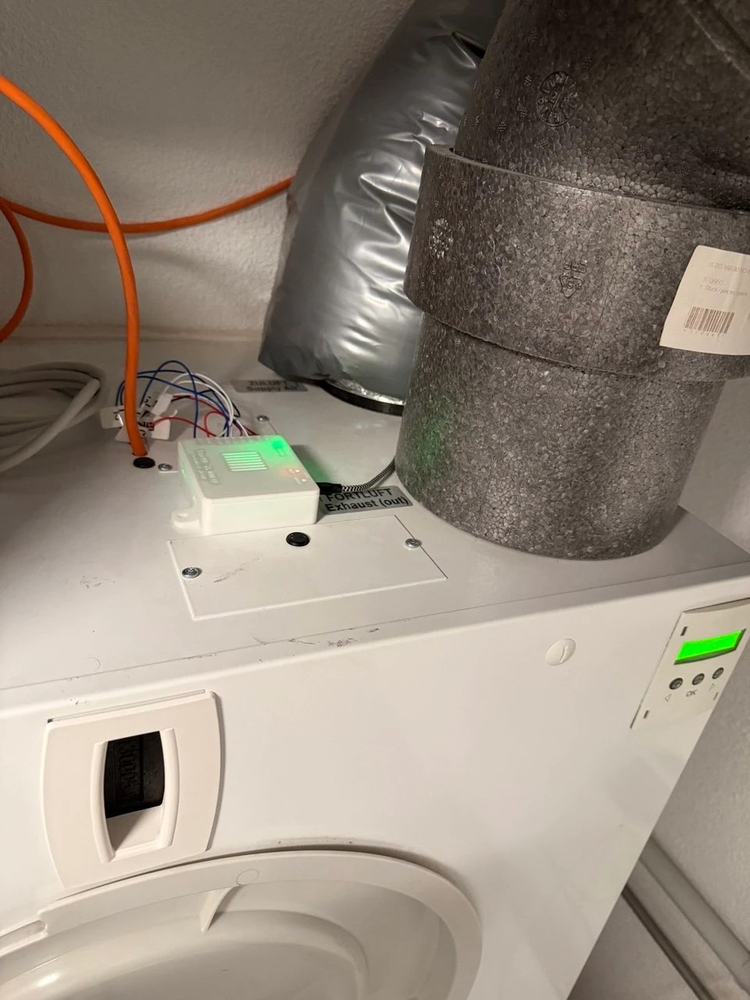
  &nbsp;
  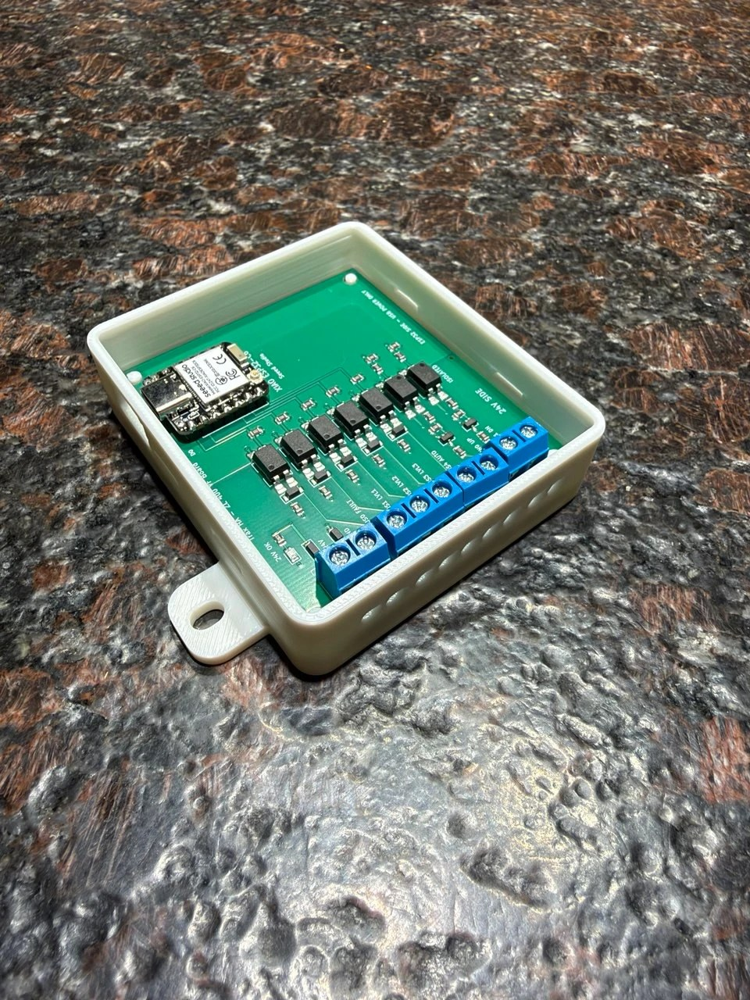
</p>
<p align="center"><sub>Links: eingebaut auf einer ZL 400 VF, Adern zur Klemmenplatine des Geräts. Rechts: Controller v3 im gedruckten Gehäuse (Deckel abgenommen).</sub></p>

Ersatz für das Wand-Bedienelement („Bedienelement Typ 1“) der Lüftungsgeräte **Dimplex ZL 300 VF / ZL 400 VF**. Ein Seeed **XIAO ESP32-C6** liest über Optokoppler die fünf 24-V-Statusausgänge des Geräts und „drückt“ über Optokoppler und PNP-Transistoren die Tasten hoch/runter. In Home Assistant erscheint das Gerät als normaler Lüfter mit drei Stufen.

**Auf einen Blick**

- **Galvanisch getrennt:** Der ESP hängt nur an USB-C. Zur 24-V-Seite des Geräts gibt es keine Kupferverbindung, nur Optokoppler.
- **Geprüfte Tastendrücke:** Jeder Druck wird über die LED-Ausgänge des Geräts kontrolliert, mit Wiederholung und Störmeldungen in Home Assistant.
- **Platine:** KiCad-10-Projekt und bestellfertige JLCPCB-Daten (Gerber, BOM, CPL).
- **Gehäuse:** Rastgehäuse ohne Schrauben, erzeugt von einem parametrischen Fusion-360-Skript.
- **Prüfung:** Worst-Case-Analyse, SPICE-Monte-Carlo und FMEA in [`docs/qa`](docs/qa).

**Stand 19.10.2026:** Eingebaut und in Betrieb an einer ZL 400 VF. Funktionstest Aus → 1 → 3 → 2 → Aus: LED-Rückmeldung bei jedem Schritt innerhalb von 3 s, keine Störmeldung.

> [!WARNING]
> Im Lüftungsgerät liegen 230 V. Vor dem Öffnen des Geräts und vor jedem Anschließen die **[Sicherheitshinweise](#sicherheit)** lesen. Nachbau auf eigene Gefahr. Kein Produkt von Dimplex.

## Inhalt

| Ordner | Inhalt |
|---|---|
| [`hardware/controller-v3`](hardware/controller-v3) | KiCad-Projekt, Schaltplan-PDF, Fertigungsdaten für JLCPCB |
| [`hardware/emulator-lab-v2`](hardware/emulator-lab-v2) | Nachbildung der Geräte-Klemmenplatine für den Labortisch (noch nicht gefertigt/getestet) |
| [`firmware`](firmware) | ESPHome-Konfiguration `trax_ha_c6.yaml`, Vorlage `secrets.example.yaml` |
| [`gehaeuse`](gehaeuse) | Gehäuse: STL, 3MF, Bambu-Studio-Projekt, STEP, Fusion-360-Skript |
| [`docs`](docs) | Prüfberichte, interaktiver Inbetriebnahme-Prüfplan, Bilder, Maßblatt |
| [`tools`](tools) | Python-Skripte für QA, Simulation und Fertigungsdaten-Check |

## Sicherheit

> [!CAUTION]
> Arbeiten am Lüftungsgerät können **lebensgefährlich** sein: Im Gerät liegt Netzspannung (230 V). Diesen Abschnitt vor Beginn vollständig lesen.

**Elektrik**

- Vor dem Öffnen des Geräts oder des Klemmenraums das Gerät **allpolig** vom Netz trennen (Sicherungsautomat bzw. Trennvorrichtung). Gegen Wiedereinschalten sichern und Spannungsfreiheit feststellen. Arbeiten an der Netzverdrahtung gehören in die Hände einer Elektrofachkraft.
- Der Controller ist **nur für den 24-V-DC-Steuerkreis** des Geräts gedacht (PCB3-Klemmen `+`, `−`, `AUS_x`, `EIN_x`).
  - Keine Klemme jemals an Netzspannung oder eine andere Spannungsquelle anschließen.
  - Absolut höchstens 30 V; über 27,5 V arbeiten Bauteile außerhalb ihrer Derating-Grenzen.
- Vor dem Anschließen an PCB3 zwischen `+` und `−` messen (Gleichspannung) und jede Ader mit dem [Verkabelungsplan](#verkabelung) vergleichen. Eine Verpolung von `+`/`−` fangen Dioden ab, andere Verdrahtungsfehler nicht.
- Bei Litzen **Aderendhülsen** verwenden, nur so weit abisolieren, wie die Klemme braucht, und jede Ader mit Zugprobe prüfen. Eine abstehende Litze kann die 24-V-Versorgung des Geräts kurzschließen.
- Die übrigen Klemmen auf PCB3 nicht verändern. Vor allem die **Brücke RM (Rauchmelder)** muss bleiben; sie ist ein Sicherheits-Abschalteingang des Geräts.
- Keine weiteren Verbraucher an die 24 V des Geräts hängen. Der Trafo ist nur für wenige Bedienelemente und Sensoren ausgelegt (Dimplex-Anleitung, Tabelle 4.1).

**ESP- / USB-Seite**

- Den XIAO nur aus einem **geprüften USB-Netzteil** versorgen (Schutzkleinspannung, CE-Kennzeichnung). Niemals aus den 24 V des Geräts speisen.
- USB-Masse oder ESP-Pins nie mit der Geräteverdrahtung verbinden. Die Trennung zwischen beiden Seiten muss erhalten bleiben.

**Gehäuse und Einbauort**

- Das gedruckte Gehäuse ist **nicht flammhemmend**: PLA und PETG erreichen nicht UL 94 V-0. Der Controller setzt nur Milliwatt um, trotzdem nicht in die Nähe von Wärmequellen und nicht in den Luftstrom eines elektrischen Heizregisters montieren.
- PLA wird ab etwa 55 °C weich; für warme Orte PETG oder ASA verwenden.
- Nur in trockenen, frostfreien Räumen einbauen (gleiche Anforderungen wie an das Gerät): kein Kondenswasser, nicht im Freien.
- Vor dem Betrieb den Deckel schließen; er schützt die Klemmen vor zufälliger Berührung.

**Lüftungsfunktion**

- Die Wohnungslüftung schützt das Gebäude vor Feuchte und Schimmel. Automationen so bauen, dass das Gerät **nie längere Zeit aus bleibt**, und die für das Gebäude nötige Mindestlüftung einhalten (z. B. Feuchteschutz nach DIN 1946-6).
- Teilt sich eine **Feuerstätte** (Kamin, Gastherme ohne eigene Zuluft o. Ä.) den Luftraum mit der Lüftung, bleiben die dafür vorgeschriebenen Sicherheitseinrichtungen (z. B. Unterdruckwächter) Pflicht. Dieser Controller ersetzt sie nicht, und eine Fernsteuerung darf sie nie übersteuern.
- Die Schutzfunktionen des Geräts (Frostschutz, Rauchmelder-Abschaltung, Filtermeldung) bleiben aktiv und dürfen nicht umgangen werden.
- Bei einem WLAN- oder Firmware-Fehler kann das Gerät auf der letzten Stufe stehen bleiben. In Home Assistant `control_failed` und `feedback_lost` überwachen; Display und Tasten am Gerät funktionieren weiter als Rückfallebene.

**Haftung**

- Nachbau und Betrieb auf eigene Gefahr. Der Anschluss fremder Elektronik kann die Gewährleistung bzw. Garantie des Lüftungsgeräts berühren. Für die Richtigkeit der Unterlagen wird keine Gewähr übernommen. Dieses Projekt steht in keiner Verbindung zu Dimplex.

## Funktionsweise

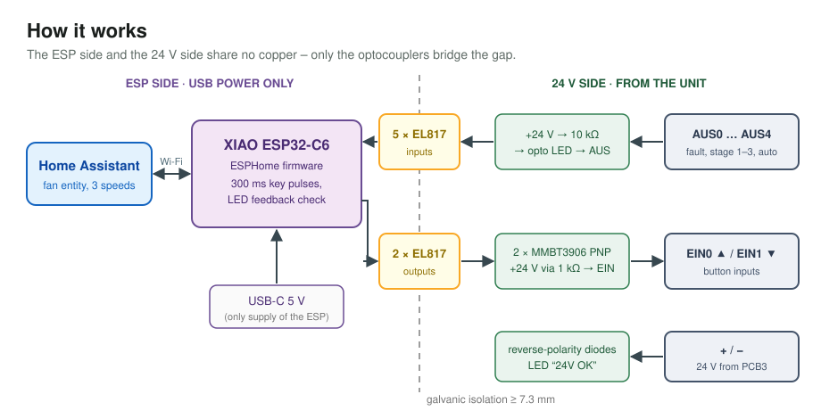

| Richtung | Schaltung |
|---|---|
| Gerät → ESP (AUS0–AUS4) | +24 V → 10 kΩ → LED im EL817 → AUS. Das Gerät schaltet AUS nach 0 V, genau wie die LEDs im Original-Bedienelement (≈ 2 mA). Ausgangsseite: 3,3 V → GPIO mit 10 kΩ Pull-down. |
| ESP → Gerät (EIN0/EIN1) | GPIO → 330 Ω → EL817 → zieht über 22 kΩ die Basis eines MMBT3906; der PNP legt +24 V über 1 kΩ auf EIN – wie der Taster im Bedienelement. Pulse von 300 ms. |
| Versorgung | ESP nur über USB-C (ein ESP an den 24 V des Geräts hatte beim Einschalten Fehler E05 ausgelöst). 24-V-Seite: Verpolschutz 1N4148W in + und −, LED „24V OK“. Last am Gerät ≈ 1–10 mA. |

## Verkabelung

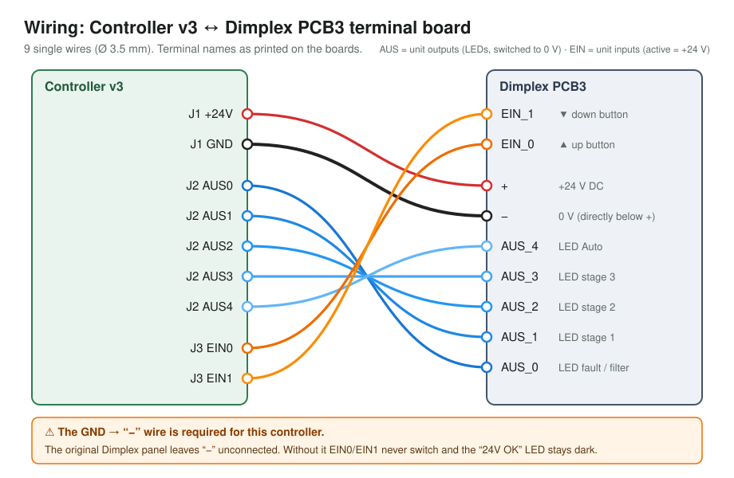

Im Gerät **Servicemenü 20 → 21 Bedienelement → „Typ1“** einstellen. Die Belegung folgt der Dimplex-Installationsanleitung ZL 300/400 VF, Kapitel 4.5.4, Abb. 4.13 ([PDF](https://www.dimplex.eu/sites/g/files/emiian586/files/media_import/medias/docus/5/Dimplex_ZL300VF_Montageanweisung-WP_DE_FD9910.pdf)).

> [!IMPORTANT]
> Anders als das Original-Bedienelement braucht dieser Controller die Ader **GND → „−“**. Vorher zwischen PCB3 „+“ und „−“ messen: Ausgelegt ist die Schaltung für 21,6–27 V (siehe [Bekannte Grenzen](#bekannte-grenzen)).

## Nachbau

### 1. Platine

<p align="center">
  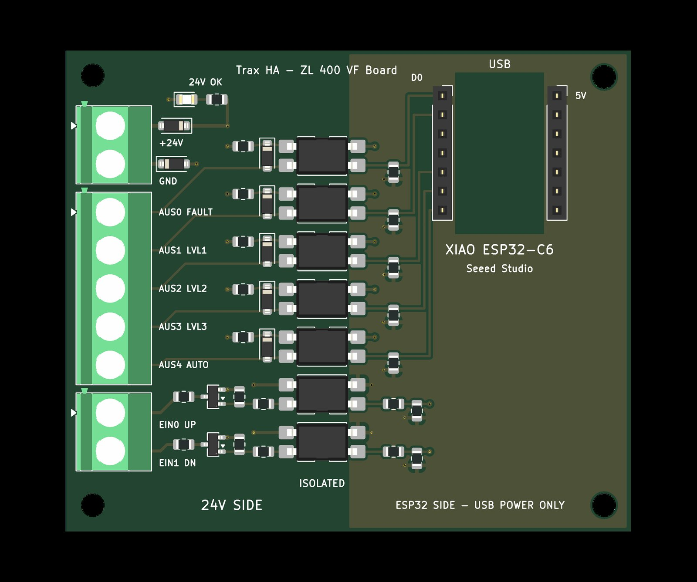
  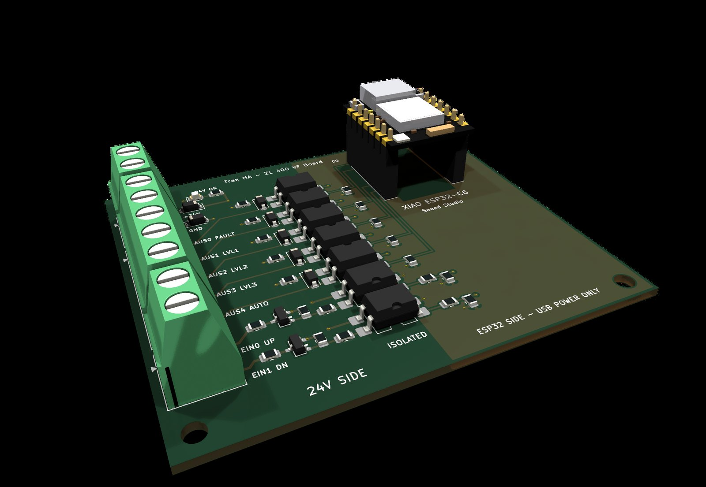
</p>

1. `hardware/controller-v3/fertigung-jlcpcb/gerbers.zip` bei JLCPCB hochladen (2 Lagen, 1,6 mm, 75 × 64 mm), PCBA Economic wählen und BOM- und CPL-Datei dazugeben. Die Drehung von Q1/Q2 (SOT-23) ist in der CPL bereits um 180° korrigiert. Die Bestückungsvorschau trotzdem kontrollieren.
2. Von Hand löten: Seeed **XIAO ESP32-C6** und Schraubklemmen im Raster 5,08 mm (2-polig J1, 5-polig J2, 2-polig J3). Der XIAO kann direkt eingelötet werden (darauf ist das Gehäuse ausgelegt) oder auf 1×7-Buchsenleisten stecken.
3. Schrittweise in Betrieb nehmen mit [`docs/Inbetriebnahme_Controller_v3.html`](docs/Inbetriebnahme_Controller_v3.html). Herunterladen und lokal öffnen; die Seite enthält Messpunkte, Multimeter-Einstellungen und Sollwerte.

| Teil (bestückt von JLCPCB) | LCSC | Anzahl | Refs |
|---|---|---|---|
| 1N4148W SOD-123 | C81598 | 7 | D1–D5, D7, D8 |
| LED grün 0805 | C2297 | 1 | D6 |
| MMBT3906 SOT-23 | C2143 | 2 | Q1, Q2 |
| EL817S SMD-4 | C63268 | 7 | U1–U7 |
| 10 kΩ 0805 | C17414 | 14 | R1–R10, R15, R16, R18, R19 |
| 22 kΩ 0805 | C17560 | 3 | R13, R14, R17 |
| 330 Ω 0805 | C17630 | 2 | R11, R12 |
| 1 kΩ 0805 | C17513 | 2 | R20, R21 |

### 2. Firmware

1. `firmware/secrets.example.yaml` nach `secrets.yaml` kopieren und ausfüllen. Diese Datei nie einchecken, sie steht in `.gitignore`.
2. `trax_ha_c6.yaml` im ESPHome-Dashboard anlegen und per USB flashen. Bei „Failed to connect“ die Taste **B (BOOT)** neben der USB-Buchse gedrückt halten, während das Kabel eingesteckt wird. Danach geht OTA.
3. In Home Assistant über die ESPHome-Integration übernehmen.

| Entität | Zweck |
|---|---|
| `fan.<gerät>_ventilation` | 3 Stufen: 33 / 66 / 100 %, aus = Gerät aus |
| `sensor.<gerät>_ventilation_level` | Ist-Stufe 0–3 aus den Geräte-LEDs |
| `sensor.<gerät>_ventilation_status` | OK / stellt ein / Störungstext |
| `binary_sensor.<gerät>_ventilation_auto`, `…_error` | Automatik, Fehler-/Filter-LED |
| `…_control_failed`, `…_feedback_lost`, `…_stuck_key_suspected` | Diagnose |
| `sensor.<gerät>_ventilation_uncommanded_changes` | Stufenwechsel, die nicht von HA kamen |
| `button.<gerät>_ventilation_clear_faults` | Diagnose zurücksetzen |

#### In Home Assistant

<p align="center">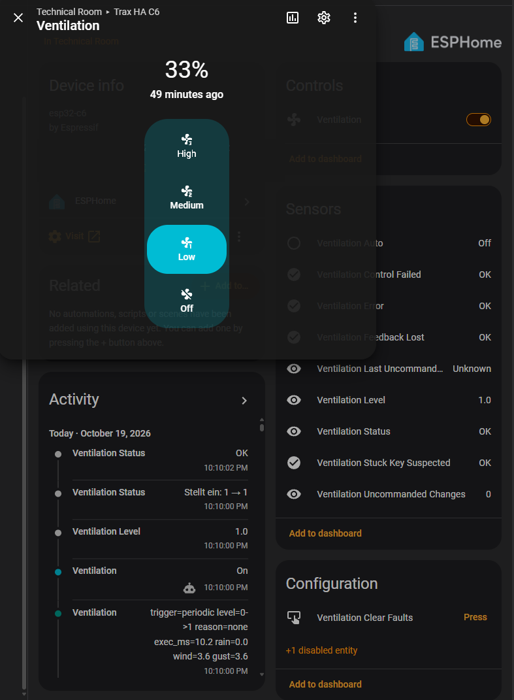</p>
<p align="center"><sub>Geräteseite mit dem Lüfter-Dialog. Das Aktivitätsprotokoll zeigt einen echten Befehl einer Automation: Lüfter an um 22:10:00, LED-Rückmeldung für Stufe 1 in derselben Sekunde, Status „OK“ um 22:10:02.</sub></p>

- Der Lüfter-Dialog zeigt **Off / Low / Medium / High**: Stufe 0–3, 0 / 33 / 66 / 100 %.
- Die Statusmeldungen:

| Status | Bedeutung |
|---|---|
| `OK` | Ruhezustand, Stufe über die LEDs des Geräts bestätigt |
| `Stellt ein: 1 → 2` | Wechselt gerade von Stufe 1 auf 2 |
| `Aus (oder 24 V fehlt)` | Gerät aus – oder gar keine 24 V bzw. kein LED-Signal |
| `Gestört/unbekannt – keine Rückmeldung` | Ein Tastendruck hat keine LED verändert (24 V, Verkabelung, EIN prüfen) |
| `Steuerung fehlgeschlagen` | Ziel trotz aller Wiederholungen nicht erreicht |
| `Verdacht Dauerdruck – Hardware prüfen (T2)` | Stufe lief gegen die gedrückte Richtung – mögliche hängende Taste |
| `Start` | Startet; Tastendrücke gesperrt bis zum ersten Abgleich |

Getestet mit ESPHome 2026.9.1 auf einem XIAO ESP32-C6.

**Stell-Logik:** Ein Stufenwunsch wird in einzelne Tastendrücke umgesetzt (300 ms Puls, 700 ms Pause). Nach jedem Druck wartet die Firmware bis zu 2 s, ob sich die Stufen-LEDs ändern. Tun sie es nicht, wiederholt sie mit Backoff (1/2/4/4 s, höchstens 10 Drücke). Beim Booten wird die Entität auf die echte Stufe gesetzt, ohne zu drücken.

```yaml
# Beispiel-Aktion in einer Automation
action: fan.set_percentage
target:
  entity_id: fan.trax_ha_c6_ventilation
data:
  percentage: 66   # 33 = Stufe 1, 66 = Stufe 2, 100 = Stufe 3; aus mit fan.turn_off
```

Die LED-Rückmeldung kommt sofort. Die Ventilatoren brauchen etwa 30–70 s, bis sie ihre Drehzahl erreicht haben.

### 3. Gehäuse

<p align="center">
  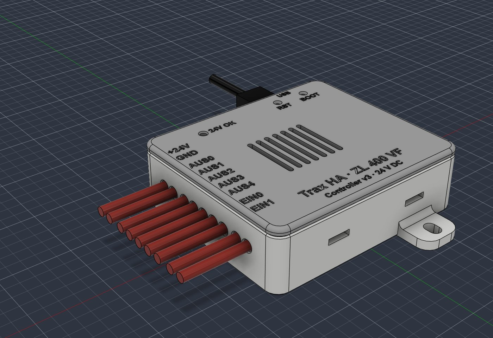
  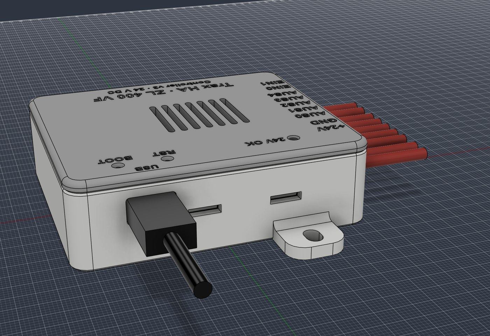
  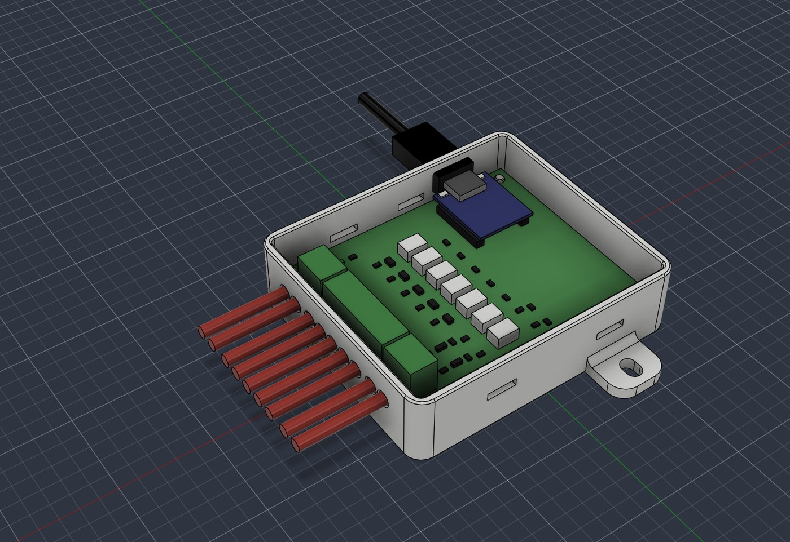
  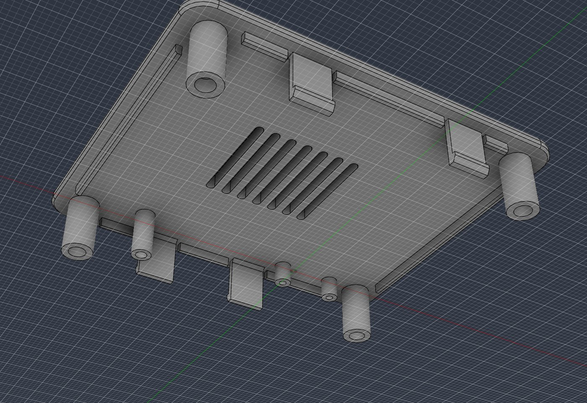
</p>

- **Größe:** 80,7 × 69,8 × 24,1 mm, mit den beiden Wandlaschen 95,8 mm lang (Langlöcher für Schrauben Ø 4).
- **Keine Kaufteile:**
  - Stifte auf den Domen fixieren die Platine, vier Niederhalter im Deckel klemmen sie.
  - Der Deckel rastet in vier Fenster ein.
  - Öffnen: Haken mit einem kleinen Schraubendreher durchs Fenster nach innen drücken.
- **Öffnungen:** neun beschriftete Kabellöcher (Ø 3,9 mm, auf Höhe der Klemmeneinführung), USB-C-Öffnung, Stiftlöcher für RESET/BOOT (Büroklammer), Lichtleiter für „24V OK“.
- **Druck** (getestet mit Bambu Lab P2S, PLA):
  - 0,2 mm Schicht, 4 Wände, 4 Bodenschichten, 15 % Füllung, ohne Stützen
  - Deckel mit der Oberseite nach unten
  - etwa 1 h 25 min und 49 g
  - Für warme Einbauorte PETG nehmen.
- **Dateien:**
  - `CentralVentilationCase_BambuStudio_P2S_PLA.3mf`: fertiges Bambu-Studio-Projekt
  - `…_Geometrie.3mf`: für andere Slicer
  - einzelne STL-Dateien
  - STEP-Baugruppe mit Platinen-Ersatzmodell
- **Ändern:** [`gehaeuse/fusion/gehaeuse_fusion.py`](gehaeuse/fusion/gehaeuse_fusion.py) baut das komplette Modell in Fusion 360 über die API neu. Alle Maße stehen oben im Skript, die Messwerte kommen aus dem [Maßblatt](docs/bilder/massblatt_controller_v3.png).

## Emulator (optional)

<p align="center">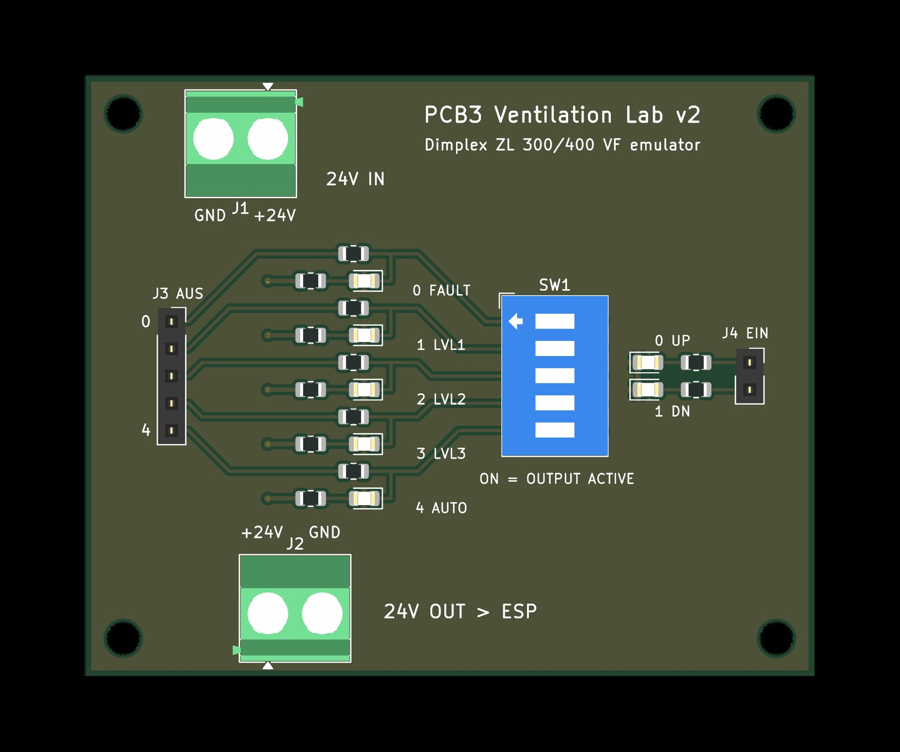</p>

Nachbildung der Geräte-Klemmenplatine für den Labortisch: DIP-Schalter ziehen AUS0–4 nach 0 V, LEDs zeigen EIN0/EIN1. **Noch nicht gefertigt und nicht getestet.** Die LED-Polungen sind in der Bestückungsvorschau nicht geprüft.

## Bekannte Grenzen

Ausführlich in [`docs/qa/QA_Verifikation_2026-10-15.md`](docs/qa/QA_Verifikation_2026-10-15.md).

- **Gerätespannung:** Ausgelegt nach EEE-INST-002-Derating für 21,6–30 V. Über **27,5 V** liegen die Ausgangs-Optokoppler U6/U7 über der Derating-Grenze (absolut 35 V), über ≈ 29 V auch R1–R5. Spannungsspitzen auf der 24-V-Leitung sind nicht gemessen.
- **Eingangsstrom an EIN:** Was das Gerät dort zieht, ist nicht gemessen. Davon hängt ab, ob R20/R21 = 1 kΩ optimal sind; bis 4 mA sieht das Gerät noch ≥ 19 V.
- **Kurzschluss an EIN:** Nur für die Pulsdauer zulässig. Dauerhaft wären es 0,5 W in R20/R21, ausgelegt sind sie für 0,125 W.
- **Dauerdruck nicht einzelfehlersicher:** Ein Kurzschluss in Q1/Q2 oder U6/U7 würde eine Taste dauerhaft drücken. Die Firmware erkennt das nur indirekt (`stuck_key_suspected`).

## Werkzeuge

`tools/qa` und `tools/verifikation` enthalten die Skripte, mit denen Schaltplan und Layout erzeugt und geprüft wurden:
- KiCad-10-Python
- ngspice über die KiCad-DLL
- gerbonara / shapely

Lokale Pfade sind durch `<PROJEKT>` bzw. `<HOME>` ersetzt und müssen vor der Benutzung angepasst werden.

## Lizenz

[MIT](LICENSE): kostenlos nutzbar, nachbaubar, veränderbar und weitergebbar, auch gewerblich. Der Lizenzhinweis muss erhalten bleiben. Die in den KiCad-Dateien eingebetteten Symbole und Footprints stammen aus den KiCad-Bibliotheken (CC-BY-SA 4.0 mit KiCad-Ausnahme für Designs) und schränken eigene Platinen nicht ein.

## Hinweise

Dimplex und ZL 400 VF sind Marken der Glen Dimplex Deutschland GmbH, XIAO ist eine Marke von Seeed Studio. Dieses Projekt steht mit keinem der beiden Unternehmen in Verbindung.
